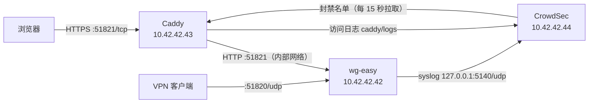

/// note | 适用范围

本文对应仓库根目录的 `docker-compose-dirty.yml`，以及 `caddy/`、`crowdsec/`、`scripts/caddy-image.sh`。如果只需要一个最简单的反向代理，看 [Caddy](./caddy.md) 即可。

///

这套部署在 wg-easy 前面加了一层 Caddy，并用 CrowdSec 自动封禁攻击者：

- Web UI 仍然使用 `51821/tcp`，但改为 HTTPS，证书自动申请和续期；在同一端口用 `http://` 访问会自动跳转到 `https://`
- 按 IP 限流登录、2FA、Basic 认证、一次性配置链接和普通 API
- CrowdSec 分析 Caddy 访问日志和 wg-easy 自己的安全日志，发现爆破后由 Caddy 直接拦截该 IP（默认 4 小时，2FA 爆破 24 小时，同一 IP 再犯时递增），可选推送到企业微信、钉钉或 Telegram

## 架构



Caddy 处理每个请求的顺序：

1. CrowdSec 封禁检查，已封禁的 IP 返回 403
2. 管理后台只允许管理员 IP（与 CrowdSec 管理员白名单是同一份名单）；同步配置接口、客户端的 OIDC 登录和 `/cnf/*` 一次性链接对所有 IP 开放；`WG_ADMIN_GATE=off` 时跳过这一步
3. `/metrics/*` 只允许内网 IP
4. 限流，超出返回 429
5. 压缩后转发给 wg-easy

### 端口

| 端口                 | 服务     | 说明                                               |
| -------------------- | -------- | -------------------------------------------------- |
| `51821/tcp`          | caddy    | Web UI（HTTPS），同端口的明文 HTTP 自动跳转        |
| `51820/udp`          | wg-easy  | WireGuard                                          |
| `80/tcp`             | caddy    | 只有 `http` 证书模式需要，其他模式可以删掉这一行   |
| `127.0.0.1:5140/udp` | crowdsec | 只在本机监听，接收 wg-easy 日志，外网访问不到      |

CrowdSec 的本地 API（8080）不对外发布，只有 Caddy 能通过内部网络访问。

## 前置条件

- Linux 服务器，Docker 20.10 或更高版本，Docker Compose v2
- 构建 Caddy 镜像时要能访问 Go 模块代理（默认 `goproxy.cn`）；也可以在别的机器上构建好推送到镜像仓库，服务器直接拉取
- 如果有用户通过 IPv6 访问 Web UI，Docker 必须开启 `ip6tables`，否则 Caddy 看到的来源 IP 全是 Docker 网关，限流和封禁都会失效。在 `/etc/docker/daemon.json` 中加入下面的配置后重启 Docker：

```json
{
    "ip6tables": true
}
```

### 服务器连不上 Docker Hub

`crowdsecurity/crowdsec`，以及编译 Caddy 用的 `caddy:2-builder-alpine`、`caddy:2-alpine`，都在 Docker Hub 上。国内服务器拉取时常见 `TLS handshake timeout`。二选一：

**方式一：腾讯云服务器用内网加速。** 只在腾讯云 CVM 和轻量应用服务器的内网可用。在 `/etc/docker/daemon.json` 中加入下面的配置（已有其他配置时合并进去），然后执行 `sudo systemctl restart docker`：

```json
{
    "registry-mirrors": ["https://mirror.ccs.tencentyun.com"]
}
```

重启 Docker 会让 wg-easy 断开几秒。执行 `docker info | grep -A1 'Registry Mirrors'` 确认生效后，直接继续下面的步骤，`.env` 不用改。

**方式二：同步到自己的 CCR 仓库。** 在能访问 Docker Hub 的机器上运行（海外机器、开了代理的电脑，或已配好方式一的腾讯云服务器）：

```shell
docker login ccr.ccs.tencentyun.com
bash scripts/mirror-images.sh
```

脚本会把 CrowdSec 和两个 Caddy 基础镜像推送到 `ccr.ccs.tencentyun.com/vpn-server/`。提示仓库不存在时，先在容器镜像服务控制台创建 `crowdsec` 和 `caddy` 两个仓库。然后在服务器的 `.env` 中设置：

```ini
CROWDSEC_IMAGE=ccr.ccs.tencentyun.com/vpn-server/crowdsec:v1.8.2
CADDY_BASE_REGISTRY=ccr.ccs.tencentyun.com/vpn-server/
```

`CADDY_BASE_REGISTRY` 只影响编译 Caddy 镜像。如果按“第 2 步 方式一”在别的机器上编译好推送，服务器只拉 `CADDY_IMAGE`，可以不设。

## 第 1 步：准备 .env

```shell
cp .env.example .env
chmod 600 .env
# 生成 Caddy 与 CrowdSec 之间的通信密钥
sed -i "s/^CROWDSEC_BOUNCER_KEY=.*/CROWDSEC_BOUNCER_KEY=$(openssl rand -hex 32)/" .env
```

`.env` 里有云 API 密钥，不要提交到 git（`.gitignore` 已经忽略了它）。

### 选择证书模式

| `CADDY_TLS_MODE`   | 证书                       | 需要填写                                                    | 80 端口 |
| ------------------ | -------------------------- | ----------------------------------------------------------- | ------- |
| `internal`（默认） | Caddy 自签                 | 无，`WG_WEB_HOST` 可以是 IP                                 | 不需要  |
| `http`             | Let's Encrypt，HTTP 验证   | `ACME_EMAIL`；`WG_WEB_HOST` 是解析到本机的域名              | 需要    |
| `tencentcloud`     | Let's Encrypt，DNS 验证    | `ACME_EMAIL`、`TENCENTCLOUD_SECRET_ID`、`TENCENTCLOUD_SECRET_KEY` | 不需要  |
| `alidns`           | Let's Encrypt，DNS 验证    | `ACME_EMAIL`、`ALIYUN_ACCESS_KEY_ID`、`ALIYUN_ACCESS_KEY_SECRET`  | 不需要  |
| `file`             | 已有证书（购买或自行申请）           | 证书和私钥放到 `caddy/certs/`，见下文“使用已有证书”                              | 不需要  |

- 只有 IP、没有域名时用 `internal`。浏览器会提示证书不受信任，导入根证书后提示消失（见下文“导入根证书”一节）。
- 国内服务器上未备案的域名可能被封 80 端口，HTTP 验证会失败，这时用 DNS 验证。
- DNS 验证的密钥请用子账号创建，只授予云解析的权限：腾讯云在 CAM 中授权“云解析 DNSPod”，阿里云在 RAM 中授权“云解析 DNS”。
- 不是 `http` 模式时，把 `docker-compose-dirty.yml` 里 caddy 的 `"80:80/tcp"` 删掉。

腾讯云 DNS 验证的 `.env` 示例：

```ini
WG_WEB_HOST=vpn.example.com
CADDY_TLS_MODE=tencentcloud
ACME_EMAIL=you@example.com
TENCENTCLOUD_SECRET_ID=AKIDxxxxxxxxxxxxxxxx
TENCENTCLOUD_SECRET_KEY=xxxxxxxxxxxxxxxx
```

### 其他配置项

| 变量                          | 默认值                                                  | 说明                                                                         |
| ----------------------------- | ------------------------------------------------------- | ---------------------------------------------------------------------------- |
| `WG_ADMIN_GATE`               | `on`                                                    | `on` 管理后台只允许管理员 IP；`off` 不按来源 IP 限制，所有 IP 都能打开登录页                                          |
| `WG_PUBLIC_PATHS`             | 见说明                                                     | 所有 IP 都能访问的路径，默认 `/api/livewireguard/* /api/auth/oidc /api/auth/oidc/* /cnf/*`，其余只允许管理员 IP |
| `RL_PUBLIC_PER_MIN`           | `30`                                                    | 公开接口每个 IP 每分钟的请求上限                                    |
| `CADDY_HSTS`                  | `max-age=0`                                             | 换成正式证书并稳定运行后改为 `max-age=31536000`                              |
| `RL_LOGIN_PER_MIN`            | `5`                                                     | 每个 IP 每分钟允许的登录和 2FA 请求次数                                      |
| `RL_LOGIN_PER_HOUR`           | `30`                                                    | 每个 IP 每小时允许的登录和 2FA 请求次数                                      |
| `CADDY_DNS_RESOLVERS`         | `119.29.29.29 223.5.5.5`                                | DNS 验证时检查 TXT 记录用的 DNS 服务器                                       |
| `CROWDSEC_DISABLE_ONLINE_API` | `false`                                                 | `true` 表示只在本地运行，不连 CrowdSec 中央服务器，也收不到社区黑名单        |
| `CROWDSEC_ENROLL_KEY`         | 空                                                      | 可选，填入后实例会出现在 app.crowdsec.net 控制台                             |
| `CROWDSEC_IMAGE`              | `crowdsecurity/crowdsec:v1.8.2`                         | Docker Hub 拉不下来时改用 CCR，见“服务器连不上 Docker Hub”                    |
| `CADDY_BASE_REGISTRY`         | 空                                                       | 编译 Caddy 的基础镜像前缀，末尾带 `/`，如 `ccr.ccs.tencentyun.com/vpn-server/` |
| `CROWDSEC_NOTIFY`             | 空                                                      | 封禁通知渠道：`wecom`、`dingtalk`、`telegram`，留空不推送，见“封禁通知”一节  |
| `CADDY_IMAGE`                 | 空                                                      | 服务器直接拉取的 Caddy 镜像；留空则使用本地镜像或现场编译                    |
| `CADDY_IMAGE_REPO`            | `ccr.ccs.tencentyun.com/vpn-server/caddy-ratelimit-dns` | `scripts/caddy-image.sh` 的推送目标                                          |
| `CADDY_VERSION`               | `2`                                                     | 插件与最新 Caddy 不兼容导致编译失败时，固定到较早的小版本，如 `2.9`          |

### 使用已有证书

已经有这个域名（或通配符域名）的证书时，用 `file` 模式。Caddy 直接加载证书，不再访问 Let's Encrypt，也不需要开放 80 端口。

1. 把证书和私钥放到 `caddy/certs/`。证书必须是 PEM 格式的完整证书链（服务器证书在前，中间证书在后），私钥不能有密码。
    - 腾讯云 SSL 证书：下载 Nginx 格式，用 `<域名>_bundle.crt` 和 `<域名>.key`
    - 阿里云 SSL 证书：下载 Nginx 格式，用 `<名称>.pem` 和 `<名称>.key`
2. 设置权限。Caddy 容器去掉了所有特权，只能读取属主是 root 的文件：

    ```shell
    sudo chown root:root caddy/certs/*
    sudo chmod 644 caddy/certs/<证书文件>
    sudo chmod 600 caddy/certs/<私钥文件>
    ```

3. 检查证书的域名、到期时间，以及证书和私钥是否配对（后两条命令的输出应完全相同）：

    ```shell
    openssl x509 -in caddy/certs/<证书文件> -noout -subject -enddate -ext subjectAltName
    openssl x509 -in caddy/certs/<证书文件> -noout -pubkey | openssl sha256
    openssl pkey -in caddy/certs/<私钥文件> -pubout | openssl sha256
    ```

4. 修改 `.env`，文件名按实际填写：

    ```ini
    CADDY_TLS_MODE=file
    CADDY_TLS_CERT_FILE=vrh.verycloud.cn_bundle.crt
    CADDY_TLS_KEY_FILE=vrh.verycloud.cn.key
    ```

5. 重建 Caddy：`docker compose -f docker-compose-dirty.yml up -d caddy`。日志里不应再出现 `obtaining certificate`。

`caddy/certs/` 下除说明文件外都被 `.gitignore` 和 `caddy/.dockerignore` 忽略，私钥不会被提交，也不会进入镜像。

/// warning | 不会自动续期

`file` 模式的证书到期前要手动更换：把新证书覆盖到 `caddy/certs/`，然后执行 `docker restart wg-easy-caddy`。

///

## 第 2 步：准备 Caddy 镜像

官方 Caddy 镜像不包含限流、DNS 验证和 CrowdSec 插件，需要自己编译。

### 方式一：构建后推送到镜像仓库（推荐）

在构建机上运行：

```shell
docker login ccr.ccs.tencentyun.com
bash scripts/caddy-image.sh --no-push    # 先只构建和检查
bash scripts/caddy-image.sh              # 构建、检查并推送
```

脚本会检查镜像里的插件是否齐全，并在 4 种证书模式下分别运行 `caddy validate`，任何一项失败都不会推送。推送成功后会打印一个带日期和提交号的固定标签，填到服务器的 `.env`：

```ini
CADDY_IMAGE=ccr.ccs.tencentyun.com/vpn-server/caddy-ratelimit-dns:2.10.2-20261109-abc1234
```

其他参数：`--platform linux/amd64,linux/arm64` 构建多架构镜像，`--no-latest` 不更新 `latest` 标签，`-h` 查看帮助。

### 方式二：在服务器上直接编译

```shell
docker compose -f docker-compose-dirty.yml build caddy
docker compose -f docker-compose-dirty.yml run --rm --no-deps caddy \
    caddy validate --config /etc/caddy/Caddyfile
```

## 第 3 步：启动

```shell
# 使用方式一的镜像
docker compose -f docker-compose-dirty.yml pull caddy
docker compose -f docker-compose-dirty.yml up -d --no-build

# 使用方式二
docker compose -f docker-compose-dirty.yml up -d
```

CrowdSec 第一次启动时会从官方仓库下载 Caddy 解析器和通用 HTTP 攻击规则，需要等一会儿。Caddy 的证书申请过程在 `docker logs -f wg-easy-caddy` 中查看，出现 `certificate obtained successfully` 即表示证书已拿到。

/// warning | 已有部署升级时

wg-easy 改用了 syslog 日志驱动，容器会被重建，VPN 会断开几秒，建议在空闲时段执行。

///

### 隧道内访问 Web UI

VPN 客户端连上隧道后再访问 `https://<WG_WEB_HOST>:51821`（例如客户端的“立即同步配置”、OIDC 回调 `/api/auth/oidc/callback`），流量会先进隧道，到 wg-easy 容器后再出公网回到服务器自己的公网 IP。这条回环路径经常走不通：服务器在路由器或防火墙的 NAT 后面且不支持 NAT 回流，或者宿主机防火墙丢弃来自 Docker 网桥的入站，表现为请求超时，而访问其他网站正常。

`deploy/wg-easy-hairpin.sh` 作为 wg-easy 的启动包装，在 wg-easy 容器内加两类规则，然后照常启动 wg-easy：

- 从 `wg0` 进来、目的端口是 `51821` 的 TCP，直接 DNAT 到 Caddy（`10.42.42.43:51821`），不再出公网。域名、证书和 URL 都不变
- 进出 `wg0` 的 TCP 做 MSS 钳制，避免 TLS 证书链这类大包在隧道里被丢

默认开启（`WG_HAIRPIN=true`），只转发目的地址是本机公网 IP 的流量。本机地址在容器启动时解析 `WG_WEB_HOST` 得到；解析不对或用 IP 访问时，在 `.env` 中用 `WG_HAIRPIN_DST4`（IPv6 用 `WG_HAIRPIN_DST6`）直接填写。域名改了解析后，要重启 wg-easy 容器。规则添加失败只打印警告，不会影响 VPN 启动。

/// warning | 多台服务器

同一份配置部署多台服务器（如 `vpn1`、`vpn2`）时，不能把 `WG_HAIRPIN_DST4` 设为 `any`。否则连着 vpn1 的隧道去同步 vpn2 的配置，请求会被 vpn1 的 Caddy 截走，客户端提示“服务端响应无效：不是有效的 JSON”。

///

验证（客户端先连上隧道，再点一次同步配置）：

```shell
docker logs wg-easy 2>&1 | grep hairpin                                   # 启动时添加的规则
docker exec wg-easy iptables -t nat -L PREROUTING -v -n | grep 51821     # pkts 计数应随访问增长
```

经过这条路径时，Caddy 看到的来源 IP 是 wg-easy 容器的 `10.42.42.42`，所有隧道内的用户共用一个限流额度；这个地址属于内网，CrowdSec 默认不会封禁。`WG_ADMIN_GATE=on` 时管理后台只允许管理员 IP，所以连着隧道时，管理员在浏览器里打开后台会被拦下（来源是 `10.42.42.42`），同步配置接口不受影响。需要在隧道内管理时，先断开隧道再访问。

### IPv4 优先（4G 客户端）

客户端走 IPv4 还是 IPv6 由 DNS 决定：域名只有 A 记录时，iOS 只会用 IPv4；在纯 IPv6 的 4G 网络上，iOS 会通过运营商的 NAT64 访问 IPv4 地址，服务端不需要做任何事。所以让客户端优先 IPv4，就是保证 wg-easy 和 Authentik 的域名**只有 A 记录、没有 AAAA**，包括 CNAME 指向的 CDN，以及 DNS 服务商的“IPv6 自动解析”或按线路（移动 / 联通 / 电信）单独配置的记录。检查：

```shell
bash scripts/diagnose-public.sh --dns vrh.verycloud.cn <Authentik 域名>
```

脚本用本机和几个公共 DNS 分别查询 A / AAAA，标出 AAAA 记录和“不同 DNS 返回不同 A 记录”的情况，并给出在 4G 热点下的电脑上对比用的 `nslookup` 命令。

服务端 wg-easy 访问 Authentik（发现、JWKS、userinfo）时默认设置 `NODE_OPTIONS=--dns-result-order=ipv4first`，Authentik 以后加了 AAAA 而服务器 IPv6 不通时，令牌校验不会先卡在 IPv6 上。可以用 `.env` 的 `WG_NODE_OPTIONS` 覆盖。

想让 IPv6 客户端直接走 IPv6，需要给域名加 AAAA，并保证服务器 IPv6 端到端可达：Docker 开启 `ip6tables`（见“前置条件”），防火墙放行 IPv6 的 51821/tcp 和 51820/udp。

### 双线服务器

域名按线路解析到两个公网 IP 时（智能解析，例如电信 / 联通走一条、移动走另一条），**两条线路都要能完整访问这套服务**，否则只有一部分用户能同步配置。需要满足三点：

1. **端口转发**：每条线路的出口设备都转发 `51821/tcp` 和 `51820/udp` 到本机，不限制来源 IP。只转发了 `51820/udp` 时，隧道能连上，但同步配置会超时，访问日志里也看不到请求。
2. **回程走原线路**：本机有两张网卡、两个网关时，从第二条线路进来的连接，回程默认会从第一条线路出去，运营商会丢掉这些包。Docker 容器的回应按目的地址选路，单纯 `ip rule from <IP>` 管不到，需要按连接打标记（CONNMARK）再查对应线路的路由表，用 `deploy/dual-line-route.sh` 处理（见下）。两条线路都由同一台前置设备转发、本机只有一个网关时，这一点由前置设备处理，本机不用改。
3. **hairpin 覆盖所有线路**：`.env` 中 `WG_HAIRPIN_DST4` 填上所有线路 IP，空格分隔，然后重建 wg-easy。

检查：

```shell
sudo bash scripts/diagnose-public.sh --lines          # 自动取 WG_WEB_HOST 在各 DNS 的解析结果
sudo bash scripts/diagnose-public.sh --capture <4G 手机公网IP>
```

`--lines` 判断每个线路 IP 是本机网卡地址还是前置设备转发，检查以它为源地址的回程从哪张网卡出去，并检查 Docker 容器的回包实际从哪张网卡出去，并给出在 4G 热点下逐条线路测试的 `curl --resolve` 命令。`--capture` 同时抓 SYN 和 SYN-ACK：两者不在同一张网卡，就是回程走错线路。

#### 修正 Docker 容器回包的线路

本机已经为每条线路配了 `from <线路IP> lookup <表>`（如 `cmc` / `cuc` / `ctc`）时，本机进程的回包没问题，但 Docker 发布的端口是 DNAT 到容器的：容器回包的源地址是 `10.42.42.x`，匹配不到这些规则，只能走 main 表的默认路由（例如内网网关）。表现为只有默认网关能路由回去的地址（公司其他出口）能同步，4G 等普通外网客户端超时，而且访问日志里看不到请求。

```shell
sudo bash deploy/dual-line-route.sh status     # 每条线路：规则是否已加、容器回包走哪张网卡
sudo bash deploy/dual-line-route.sh apply      # 立即生效（幂等）
sudo bash deploy/dual-line-route.sh install    # 安装 systemd 服务 wg-easy-dual-line，开机自动生效
sudo bash deploy/dual-line-route.sh remove     # 回退
```

还有一个更隐蔽的问题：DNAT 发生在路由之前，内核做反向路径检查（`rp_filter`）时目的地址已经是 `10.42.42.x`，同样匹配不到 `from <线路IP>`，反向路由查到默认网关所在的内网网卡。`rp_filter=1`（严格，很多发行版的默认值）时，从线路网卡进来、转给容器的 SYN 会被内核直接丢弃，客户端表现为 TCP 连接超时；本机 sshd 等不经 DNAT 的服务完全正常，所以平时看不出来。

脚本自动发现 `ip rule` 里的线路（IP 在本机网卡上、对应的表有默认路由），每条线路分配一个标记：从这张网卡进来的新连接打上连接标记，容器的回包恢复标记后按 `fwmark` 查这条线路的表；同时把线路网卡的 `rp_filter` 设为 `2`（宽松，`remove` 时恢复原值）。只改 mangle 表和 `ip rule`，不动 Docker 的 nat / filter 规则，也不影响从内网网卡进来的连接。`firewalld --reload` 会清掉 mangle 规则，之后重新 `apply`（或 `systemctl restart wg-easy-dual-line`）。

#### 清理重复的策略路由

`ip rule` 里同一条 `from <线路IP> lookup <表>` 出现几十次，说明添加它的配置每次执行都直接 `ip rule add`，没有先判断是否已存在。功能上不影响，但规则越积越多、排查困难，也会让 0.2.4 及以前的 `dual-line-route.sh` 误判线路数。

```shell
sudo bash deploy/dual-line-route.sh dedupe   # 只查看：重复的规则、计划删除哪些、是哪个配置在重复添加
sudo bash deploy/dual-line-route.sh apply    # 先清理（每组只保留优先级数字最大的那条），再添加线路规则
```

`apply`（包括 `install` 后开机自动执行的 `apply`）默认都会先清理重复规则；不想清理时加环境变量 `DUAL_LINE_DEDUPE=0`，例如 `sudo DUAL_LINE_DEDUPE=0 bash deploy/dual-line-route.sh install`。清理掉的重复规则 `remove` 不会加回来。

清理前后对每个线路 IP 执行 `ip route get 1.1.1.1 from <IP>`，选路结果有任何变化就把删除的规则全部加回去；不碰 local / main / default 和 fwmark 规则。它只清理当前生效的规则，还要修正来源，否则下次网络重启又会重复：

- CentOS / RHEL 的 `/etc/sysconfig/network-scripts/rule-<网卡>`：每行加固定优先级，例如 `from 112.82.212.165 table cuc priority 1001`。带固定优先级后，较新的内核会拒绝重复添加完全相同的规则
- 脚本、`rc.local`、`/etc/network/interfaces` 的 `post-up`、crontab：改成先删干净再加，`while ip rule del from <IP> lookup <表> 2>/dev/null; do :; done; ip rule add from <IP> lookup <表> priority <固定数字>`

## 第 4 步：验证

下面的 `<WG_WEB_HOST>` 换成 `.env` 中的值。`internal` 模式下 curl 需要加 `-k`。

### HTTPS 和自动跳转

```shell
curl -kI https://<WG_WEB_HOST>:51821    # 应返回 200
curl -I  http://<WG_WEB_HOST>:51821     # 应返回 308，Location 是 https://
```

如果用 `http://` 访问返回 400 `Client sent an HTTP request to an HTTPS server`，说明同端口跳转没有生效，见文末“排错”一节。

### 安全响应头

```shell
curl -skI https://<WG_WEB_HOST>:51821 | grep -iE 'strict-transport|x-frame|x-content-type|content-security|^server'
```

应该看到 HSTS、`X-Frame-Options`、`X-Content-Type-Options`、`Content-Security-Policy`，并且没有 `Server` 头。

### Caddy 拿到的是真实客户端 IP（最重要）

从外网访问几次 Web UI，然后：

```shell
tail -n 20 caddy/logs/access.log | grep -o '"client_ip":"[^"]*"' | sort | uniq -c
```

应该是访问者的公网 IP。如果全是 `10.42.42.1` 或 `fdcc:ad94:bacf:61a3::1`（Docker 网关），所有请求都会被当作内网放行，限流共用一个额度，CrowdSec 也永远不会封任何人。IPv6 访问出现这种情况时，检查“前置条件”中的 `ip6tables`。

### 限流

从公网 IP 连续提交 6 次错误密码，前 5 次返回 401，第 6 次返回 429：

```shell
for i in $(seq 6); do
    curl -sk -o /dev/null -w "%{http_code}\n" -X POST \
        -H 'Content-Type: application/json' \
        -d '{"username":"x","password":"x","remember":false}' \
        https://<WG_WEB_HOST>:51821/api/auth/password
done
```

### CrowdSec

```shell
# Caddy 已连上 CrowdSec：caddy 这一行的最后拉取时间在不断更新
docker exec wg-easy-crowdsec cscli bouncers list

# 两条日志都在读：caddy/logs/access.log 和 syslog 的行数都在增长
docker exec wg-easy-crowdsec cscli metrics

# 本项目的 5 条规则和 1 个解析器都已加载
docker exec wg-easy-crowdsec cscli scenarios list | grep wg-easy
docker exec wg-easy-crowdsec cscli parsers list | grep wg-easy
```

确认 wg-easy 的 2FA 失败日志能被识别（结果中 `wg-easy/security-logs` 应显示成功，`wg-easy/2fa-bf` 应收到这条事件）：

```shell
docker exec wg-easy-crowdsec cscli explain --type syslog \
    --log 'Nov  9 17:00:00 host wg-easy[1]: Security failure: type=2fa ip=203.0.113.9'
```

最后手动封一个测试 IP，等 15 秒后从该 IP 访问应返回 403。测完用 `alerts delete` 清掉，它会连同封禁记录一起删除，不会让这个 IP 以后的封禁时长递增：

```shell
docker exec wg-easy-crowdsec cscli decisions add --ip <测试IP> --duration 5m
docker exec wg-easy-crowdsec cscli alerts delete --ip <测试IP>
```

测试递增：先给测试 IP 加两次 1 分钟的手动封禁，等它们过期（约 1 分 15 秒），再从该 IP 访问 6 次不存在的一次性链接，触发 `wg-easy/cnf-enum`。这次封禁应为 12 小时（按第 3 次算），测完同样用 `alerts delete` 清掉：

```shell
docker exec wg-easy-crowdsec cscli decisions add --ip <测试IP> --duration 1m
docker exec wg-easy-crowdsec cscli decisions add --ip <测试IP> --duration 1m
# 约 1 分 15 秒后，在测试 IP 上执行
for i in $(seq 6); do curl -sk -o /dev/null -w "%{http_code}\n" https://<WG_WEB_HOST>:51821/cnf/test$i; done
# 回到服务器，Duration 一列应接近 12h
docker exec wg-easy-crowdsec cscli decisions list --ip <测试IP>
docker exec wg-easy-crowdsec cscli alerts delete --ip <测试IP>
```

/// note | 测试要用公网 IP

内网地址（`10.0.0.0/8`、`172.16.0.0/12`、`192.168.0.0/16` 等）默认在 CrowdSec 白名单里，从局域网怎么测都不会被封。

///

## 检测规则

规则定义在 `crowdsec/scenarios/wg-easy.yaml`。封禁时长在 `crowdsec/profiles.yaml` 中设置：`wg-easy/2fa-bf` 首次封 24 小时，其余规则首次封 4 小时，同一 IP 再犯时递增（见下文“重复违规递增封禁”）。

| 规则                       | 判断依据                                                    | 触发条件                                 |
| -------------------------- | ----------------------------------------------------------- | ---------------------------------------- |
| `wg-easy/password-bf`      | `POST /api/auth/password` 返回 401                          | 同一 IP 超过 10 次（每分钟抵消 1 次）    |
| `wg-easy/credential-bf`    | 带 `Authorization` 头访问 `/api/*` 仍返回 401               | 同一 IP 超过 10 次（每分钟抵消 1 次）    |
| `wg-easy/cnf-enum`         | `/cnf/*` 返回 404（链接无效或已被使用）                     | 同一 IP 超过 5 次（每分钟抵消 1 次）     |
| `wg-easy/rate-limit-abuse` | 收到 Caddy 返回的 429                                       | 同一 IP 超过 20 次（每 30 秒抵消 1 次）  |
| `wg-easy/2fa-bf`           | wg-easy 日志 `Security failure: type=2fa`（验证码错误）     | 同一 IP 超过 5 次（每 2 分钟抵消 1 次）  |

另外还会启用 CrowdSec 官方的 `crowdsecurity/caddy` 规则集（目录扫描、已知漏洞探测等）。

wg-easy 在 2FA 验证码错误时返回 HTTP 200，访问日志看不出来，所以 `2fa-bf` 改为读取 wg-easy 自己的日志。日志通过 Docker 的 syslog 日志驱动发给 CrowdSec，不需要挂载 `docker.sock`。解析器只取每行最后一个 `ip=`，用户名里写入的 `ip=...` 不会被当作来源 IP，攻击者无法借此让别人被封。

/// danger | 2FA 规则被触发

能走到 2FA 这一步，说明攻击者已经输对了密码。看到 `wg-easy/2fa-bf` 告警时，请立即修改该账号的密码。

///

### 重复违规递增封禁

同一个 IP 再次被封时，封禁时长按它过去 7 天内已有的封禁次数递增：

| 规则                                  | 第 1 次 | 第 2 次 | 第 3 次 | 之后          | 上限          |
| ------------------------------------- | ------- | ------- | ------- | ------------- | ------------- |
| `wg-easy/2fa-bf`                      | 24h     | 48h     | 72h     | 每次加 24h    | 168h（7 天）  |
| 其他 wg-easy 规则、CrowdSec 官方规则  | 4h      | 8h      | 12h     | 每次加 4h     | 72h           |
| 网段封禁                              | 4h      | 4h      | 4h      | 不递增        | -             |

- 次数不分规则：一个 IP 先因扫描被封过 2 次，再爆破 2FA，按第 3 次算，封 72 小时
- 7 天与 CrowdSec 默认的告警保留时长一致，更早的记录会被清理，计数自然归零
- 计算公式写在两份 profiles 文件的 `duration_expr` 中，`decisions` 下的 `duration` 是公式出错时的兜底值

## 封禁通知

可选。CrowdSec 封禁 IP 时推送一条消息到企业微信、钉钉或 Telegram 群。

- 只推送 wg-easy 专用规则（上表 5 条）的封禁；官方规则（扫描、漏洞探测）照常封禁但不推送，避免刷屏
- 30 秒内的多次封禁合并成一条消息，一条最多列 8 个 IP
- `wg-easy/2fa-bf` 标为高危，消息里提示修改密码，并 @所有人（Telegram 不支持 @所有人）
- 社区黑名单下发的封禁不经过本地规则，不会推送

### 配置

在 `.env` 中选择渠道并填写对应的密钥，其余渠道的密钥留空：

| `CROWDSEC_NOTIFY` | 需要填写                                              | 获取方式                                                                                     |
| ----------------- | ----------------------------------------------------- | -------------------------------------------------------------------------------------------- |
| 留空（默认）      | 无                                                    | 不推送                                                                                       |
| `wecom`           | `NOTIFY_WECOM_KEY`                                    | 企业微信群 → 添加群机器人，webhook 地址中 `key=` 后面的部分                                  |
| `dingtalk`        | `NOTIFY_DINGTALK_TOKEN`                               | 钉钉群设置 → 机器人 → 自定义机器人，webhook 地址中 `access_token=` 后面的部分                |
| `telegram`        | `NOTIFY_TELEGRAM_TOKEN`、`NOTIFY_TELEGRAM_CHAT_ID`    | @BotFather 创建机器人得到 token；给机器人发一条消息后，访问 `getUpdates` 接口查看 `chat.id`  |

/// warning | 钉钉安全设置

钉钉机器人的安全设置必须选“自定义关键词”，关键词填 `wg-easy`。不支持“加签”：签名要按发送时间实时计算，而 CrowdSec 的推送地址是固定的。

///

修改后重建 CrowdSec 容器：

```shell
docker compose -f docker-compose-dirty.yml up -d crowdsec
```

`CROWDSEC_NOTIFY` 决定挂载哪两个文件：留空时挂载 `crowdsec/profiles.yaml` 和占位文件 `crowdsec/notifications/off.yaml`，有值时挂载 `crowdsec/profiles-notify.yaml` 和 `crowdsec/notifications/<渠道>.yaml`。只能填上表中的值，填错时 Docker 会把不存在的路径当作目录创建，通知不会生效。

### 验证

```shell
# wg_easy_notify 一行应显示已启用，并关联 wg_easy_2fa_bf、wg_easy_ip_remediation 两个规则
docker exec wg-easy-crowdsec cscli notifications list

# 发一条测试消息（直接发给通知插件，不经过处置规则）
docker exec wg-easy-crowdsec cscli notifications test wg_easy_notify
```

部分 CrowdSec 版本的 `cscli notifications test` 不会展开推送地址里的环境变量，测试消息收不到但实际封禁能正常推送。可以用真实告警重新走一遍处置流程来验证：

```shell
docker exec wg-easy-crowdsec cscli alerts list                     # 找一条 wg-easy/ 开头的告警 ID
docker exec wg-easy-crowdsec cscli notifications reinject <告警ID>
```

还没有 wg-easy 告警时，按“第 4 步：验证”从公网 IP 连续输错 6 次 2FA 验证码，就会产生一条高危告警和推送，测完记得解封。

### 推送官方规则的封禁

编辑 `crowdsec/profiles-notify.yaml`，取消 `default_ip_remediation` 下 `notifications` 两行的注释，然后执行 `docker restart wg-easy-crowdsec`。

## 日常运维

### 查看日志和封禁

```shell
tail -f caddy/logs/access.log                       # Caddy 访问日志（JSON）
docker logs -f wg-easy                              # wg-easy 日志
docker logs -f wg-easy-caddy                        # Caddy 运行日志（证书申请等）
docker exec wg-easy-crowdsec cscli alerts list      # 告警记录
docker exec wg-easy-crowdsec cscli decisions list   # 当前封禁
docker exec wg-easy-crowdsec cscli decisions delete --ip <IP>   # 解封
docker exec wg-easy-crowdsec cscli alerts delete --ip <IP>      # 解封并清零递增计数
```

### 管理员 IP 白名单

管理员 IP 只维护一份：`crowdsec/parsers/s02-enrich/wg-easy-whitelist.yaml`。它同时决定两件事：

- **永不被 CrowdSec 封禁**
- **可以进入管理后台**：Caddy 只放行这些 IP；`WG_PUBLIC_PATHS` 里的路径对所有 IP 开放（默认同步配置接口 `/api/livewireguard/*`、客户端同步前的 OIDC 登录 `/api/auth/oidc` 和回调 `/api/auth/oidc/*`、一次性链接 `/cnf/*`），其余请求返回 403（带 `X-Wg-Gate: admin-only` 头）

开关 `WG_ADMIN_GATE`（默认 `on`）。需要让所有 IP 都能打开 wg-easy 登录页时设为 `off`：Caddy 不再按来源 IP 拦截任何路径，管理后台靠 wg-easy 自己的密码 + 2FA / OIDC 登录保护，外加登录限流和 CrowdSec 封禁；白名单仍然生效，里面的 IP 永远不会被 CrowdSec 封禁。修改后执行 `docker compose -f docker-compose-dirty.yml up -d --no-build --force-recreate caddy`。值只能是 `on` 或 `off`，写错时 Caddy 启动失败。

Caddy 读不了 YAML，所以由 `scripts/admin-ips.sh` 把名单转成 `caddy/admin-ips.caddy`。修改流程：

```shell
# 1. 编辑 crowdsec/parsers/s02-enrich/wg-easy-whitelist.yaml，格式为 - "1.2.3.4"
bash scripts/admin-ips.sh                     # 2. 重新生成 caddy/admin-ips.caddy
docker restart wg-easy-crowdsec wg-easy-caddy  # 3. 两边同时生效
```

`commit.sh` 提交前会检查 `caddy/admin-ips.caddy` 是否与 YAML 一致。公开接口仍然受 CrowdSec 封禁、限流（`RL_PUBLIC_PER_MIN`）和 wg-easy 自身认证的约束；客户端用错误的令牌反复请求时，会触发 `wg-easy/credential-bf` 被封。

排查公开接口访问不到时，在服务器的 wg-easy 目录下运行：

```shell
bash scripts/diagnose-public.sh                     # 默认检查 /api/livewireguard/config
bash scripts/diagnose-public.sh /api/auth/oidc/callback
bash scripts/diagnose-public.sh --ip <客户端公网IP>    # 这个 IP 最近的全部请求
bash scripts/diagnose-public.sh --watch               # 实时观察：启动时先发一个自检请求，看到自检记录后再去客户端点同步
bash scripts/diagnose-public.sh --watch <客户端公网IP> # 只看这个 IP 的请求
sudo bash scripts/diagnose-public.sh --capture        # 抓发往 51821 的新 TCP 连接，和 --watch 对照
bash scripts/diagnose-public.sh --oidc                # 列出 OIDC 端点，生成在客户端网络上执行的测试命令
bash scripts/diagnose-public.sh --setup '<设置链接>'   # 解码 App 实际使用的 issuer / endpoint 并生成测试命令（首页“复制链接”）
bash scripts/diagnose-public.sh --dns <域名> <Authentik 域名>  # 查 A / AAAA 记录和不同 DNS 线路的解析结果
sudo bash scripts/diagnose-public.sh --lines           # 双线服务器：检查每条线路的入口和回程，打印修正命令
sudo bash scripts/diagnose-public.sh --trace 60        # 60 秒内在 4G 上测试，逐层计数定位丢包位置
```

脚本依次检查：容器里的 Caddyfile 和管理员名单是不是新版、路径是否在 `WG_PUBLIC_PATHS` 里、wg-easy 自己对这个路径返回什么、经过 Caddy 返回什么、访问日志和 CrowdSec 封禁，最后列出最近被管理员 IP 规则拦下的路径（客户端需要但没有开放的路径就在这里），并检查 OIDC 服务能否访问。客户端同步超时，而 `--watch` 里没有出现任何请求，说明请求根本没到这台服务器：检查客户端填的服务器地址、上游防火墙或安全组，以及客户端所在网络能否访问 OIDC 服务（第 8 步给出了测试命令）。经过 Caddy 的结果这样看：

| 结果                            | 含义                                                     |
| ------------------------------- | -------------------------------------------------------- |
| 403，带 `X-Wg-Gate: admin-only` | 被管理员 IP 判断拦下：路径不在 `WG_PUBLIC_PATHS` 里       |
| 403，没有 `X-Wg-Gate`           | 来源 IP 被 CrowdSec 封禁                                 |
| 429                             | 触发限流                                                 |
| 502                             | Caddy 连不上 wg-easy                                     |
| 没有响应（连接被断开）          | 容器里还是旧版 Caddyfile，需要 `--force-recreate` 重建   |
| 其他状态码（200、400、401、404）| 请求已经到了 wg-easy；404 表示当前镜像里没有这个接口     |

### 调整封禁时长

封禁时长在 `crowdsec/profiles.yaml` 和 `crowdsec/profiles-notify.yaml` 中，两份文件要保持一致。修改递增步长或上限时，改 `duration_expr` 里的数字（如 `* 4` 和 `72`），同一行出现两次的数字要一起改；`duration_expr` 必须和 `decisions` 平级，写进 `decisions` 下面不会生效。改完先检查配置，再重启：

```shell
docker exec wg-easy-crowdsec crowdsec -t
```


```shell
docker restart wg-easy-crowdsec
```

### 更新和回滚 Caddy 镜像

在构建机上重新运行 `bash scripts/caddy-image.sh`，把新的固定标签填到服务器 `.env` 的 `CADDY_IMAGE`，然后：

```shell
docker compose -f docker-compose-dirty.yml pull caddy
docker compose -f docker-compose-dirty.yml up -d --no-build caddy
```

回滚时把 `CADDY_IMAGE` 改回旧标签，再执行一次上面两条命令。

### 更新 CrowdSec 规则

```shell
docker exec wg-easy-crowdsec cscli hub update
docker exec wg-easy-crowdsec cscli hub upgrade
docker restart wg-easy-crowdsec
```

### 更换 CrowdSec 通信密钥

CrowdSec 只在第一次注册时读取 `CROWDSEC_BOUNCER_KEY`，之后修改需要先删除旧的注册：

```shell
docker exec wg-easy-crowdsec cscli bouncers delete caddy
# 修改 .env 中的 CROWDSEC_BOUNCER_KEY 后
docker compose -f docker-compose-dirty.yml up -d --force-recreate crowdsec caddy
```

### 导入根证书（internal 模式）

`internal` 模式的根证书在 `caddy/data/caddy/pki/authorities/local/root.crt`。复制到客户端后：

- Windows：双击证书，选择“安装证书”，存储位置选“受信任的根证书颁发机构”
- macOS：用“钥匙串访问”导入，并设为“始终信任”
- 手机：在系统设置中安装证书并手动启用信任

不要删除 `caddy/data`，否则会重新生成根证书，客户端需要重新导入。

### 备份

| 路径                  | 内容                                     |
| --------------------- | ---------------------------------------- |
| `data/`               | WireGuard 私钥和 wg-easy 数据库，最重要  |
| `caddy/data/`         | 证书、私钥、ACME 账号、自签根证书        |
| `.env`                | 所有配置和密钥                           |
| `crowdsec_config` 卷  | CrowdSec 配置（可选，丢失后会自动重建）  |

### 同步上游 wg-easy（wg-easy-feng）

本库的 wg-easy 程序本身以 `feng905/wg-easy` 的 `LiveWireGuard` 分支为上游（本机目录 `../wg-easy-feng`），本库只在其上叠加 Caddy、CrowdSec 等部署层。同步上游改动：

```shell
bash scripts/sync-upstream.sh --dry-run   # 先预览：待合并的提交、两边都改过的文件、git 预测的冲突
bash scripts/sync-upstream.sh             # 合并并提交（自动打版本 tag），不推送
bash scripts/sync-upstream.sh --continue  # 手工处理完冲突或检查问题后，重新检查并提交
```

脚本会添加名为 `feng` 的远程，拉取后用 `git merge` 合并（保留双方历史，以后可以反复同步）。冲突按下面的规则自动处理：

| 文件 | 处理 |
| ---- | ---- |
| `caddy/`、`crowdsec/`、`deploy/`、本库脚本、`docker-compose-dirty.yml`、本部署文档、`.gitattributes`、`.githooks/` | 保留本库 |
| `.gitignore` | 两边的行取并集 |
| `.env.example` | 保留本库，再追加上游新增的变量 |
| 其余文件（wg-easy 源码、文档、构建文件） | 采用上游 |

合并前会建备份分支 `backup/pre-sync-<时间>`；合并后检查本库脚本语法、管理员 IP 名单、部署文件换行符、compose 文件，以及本库自有的 src 改动引用的模块和 `Database.*` 方法在合并结果里是否还存在。检查不通过就不提交，合并结果留在工作区：处理后运行 `--continue`，放弃则 `git merge --abort`。脚本最后会列出“只有本库有的 src 文件”和“本库改动被上游覆盖的文件”，需要人工确认。想全部手工解决冲突时加 `--manual`；上游改用 GitHub 地址时设置 `FENG_URL=https://github.com/feng905/wg-easy.git`。

合并后先构建 wg-easy 镜像验证（`docker build -t wg-easy:sync-test .`），没问题再推送；有问题执行 `git reset --hard backup/pre-sync-<时间>` 回退。

## 排错

| 现象                                                         | 原因和处理                                                                                                                                 |
| ------------------------------------------------------------ | ------------------------------------------------------------------------------------------------------------------------------------------ |
| compose 报 `请在 .env 中设置 ...`                            | `WG_WEB_HOST` 或 `CROWDSEC_BOUNCER_KEY` 没有填写                                                                                           |
| `http://` 访问返回 400 `Client sent an HTTP request to an HTTPS server` | Caddyfile 中站点地址被加了 `bind`，导致 `servers :51821` 匹配不上，跳转失效。去掉 `bind` 即可                              |
| `http` 模式证书申请失败                                      | 确认域名解析到本机、80 端口公网可达；国内未备案域名可能被封 80 端口，改用 DNS 验证                                                         |
| DNS 模式证书申请失败                                         | 确认域名托管在所选的云厂商、密钥有云解析权限；在 `docker logs wg-easy-caddy` 中查看具体错误                                                |
| 编译 Caddy 镜像失败，错误与 `libdns` 有关                    | 插件与最新 Caddy 不兼容，在 `.env` 中设置 `CADDY_VERSION=2.9` 后重新编译                                                                   |
| Caddy 启动报 `permission denied`                             | 容器去掉了越权写文件的权限，执行 `sudo chown -R root:root caddy/data caddy/config caddy/logs`                                              |
| 登录不了或频繁返回 429                                       | 多个用户共用一个出口 IP（如公司网络），适当调大 `RL_LOGIN_PER_MIN`，或把该 IP 加入 CrowdSec 白名单                                         |
| 访问日志里 `client_ip` 全是 Docker 网关地址                  | 见“第 4 步：验证”中的真实 IP 检查，IPv6 需要开启 `ip6tables`                                                                                          |
| `cscli bouncers list` 中 caddy 没有拉取记录                  | 两边密钥不一致，按“更换 CrowdSec 通信密钥”一节重新注册                                                                            |
| `cscli metrics` 中 syslog 行数为 0                           | 检查 Docker 版本（需 20.10+），以及 `docker inspect wg-easy --format '{{.HostConfig.LogConfig}}'` 是否为 syslog 驱动                       |
| 自己被封了                                                   | 在服务器上执行 `cscli alerts delete --ip <IP>`（解封并清零递增计数），并把自己的 IP 加入 CrowdSec 白名单                                                      |
| 收不到封禁通知                                               | 先看“封禁通知 → 验证”；再看 `docker logs wg-easy-crowdsec` 中 `http-plugin` 的报错。国内服务器通常连不上 Telegram                          |
| 拉取镜像报 `TLS handshake timeout`，地址是 `registry-1.docker.io` | 服务器连不上 Docker Hub，见“前置条件 → 服务器连不上 Docker Hub” |
| 登录页提示“无法通过不安全连接登录。请使用 HTTPS。” | 浏览器地址是 `http://`，而且页面是 wg-easy 直接返回的，没有经过 Caddy：通常是旧的 wg-easy 容器还在占用宿主机 51821（`docker ps` 能看到 `0.0.0.0:51821->51821/tcp` 映射在 wg-easy 上），或者 Caddy 没有运行。确认 Caddy 镜像可用后，执行 `docker compose -f docker-compose-dirty.yml up -d --force-recreate --remove-orphans` |
| `http` 模式日志报 `Timeout during connect (likely firewall problem)` 或 `Cannot negotiate ALPN protocol` | 80 或 443 端口从公网访问不到，或被其他服务占用。改用 DNS 验证，或用已有证书（`file` 模式） |
| `file` 模式启动报 `loading certificates` / `no such file` / `permission denied` | 文件名与 `CADDY_TLS_CERT_FILE`、`CADDY_TLS_KEY_FILE` 不一致，或文件属主不是 root。按“使用已有证书”第 2 步设置权限 |
| 浏览器提示证书不受信任，但证书是购买的 | 证书文件缺少中间证书。使用证书厂商提供的 bundle / fullchain 文件 |
| VPN 隧道连上后，访问 Web UI 或 OIDC 回调超时，访问其他网站正常 | 流量绕公网回到服务器自己被拦住。确认 `WG_HAIRPIN=true`，并按“隧道内访问 Web UI”检查规则计数 |
| 多台服务器时，连着一台的隧道同步另一台的配置，提示“不是有效的 JSON” | 隧道内的转发规则没有限定目的地址，请求被当前隧道所在服务器的 Caddy 截走。更新 `deploy/wg-easy-hairpin.sh` 后重建 wg-easy，确认日志里“本机地址”只有本机公网 IP |
| 所有请求 502，Caddy 日志 `dial tcp 10.42.42.42:51821: connect: connection refused`；wg-easy 日志 `listen EADDRNOTAVAIL ... <公网IP>:51821` | wg-easy 的 `HOST` 环境变量被改成了域名。旧版 `deploy/wg-easy-hairpin.sh` 有这个问题，更新脚本后执行 `docker compose -f docker-compose-dirty.yml up -d --no-build --force-recreate wg-easy` |
| 管理员打不开后台（403，带 `X-Wg-Gate: admin-only` 头），同步配置正常 | 当前出口 IP 不在 CrowdSec 管理员白名单里，或改了名单后没有运行 `bash scripts/admin-ips.sh` 并重启 Caddy。连着 VPN 隧道时来源是 `10.42.42.42`，同样会被拦下 |
| 非管理员 IP 的客户端同步配置失败，curl 测 `/api/livewireguard/config` 却正常 | 客户端同步还会访问别的路径（如 OIDC 登录 `/api/auth/oidc/callback`）。运行 `bash scripts/diagnose-public.sh` 看第 6 步列出的被拦路径，加进 `WG_PUBLIC_PATHS` |
| 非管理员 IP 同步超时，访问日志里没有这个客户端的请求 | 请求没到 Caddy：客户端连的是另一台服务器、上游防火墙只放行部分来源，或者 OIDC 服务（Authentik）只对内网开放，客户端拿不到令牌。用 `diagnose-public.sh --watch` 和第 8 步定位 |
| 设置 `WG_ADMIN_GATE=off` 后非白名单客户端仍同步超时，`--watch` 里没有记录 | 请求没进入 Caddy 的 HTTP 处理：用 `--capture` 看有没有 TCP 新连接（有 = TLS 握手失败；没有 = 没到服务器），用 `--oidc` 生成的命令在客户端网络上测 OIDC 各端点 |
| `WG_ADMIN_GATE=off`、不连隧道时，白名单 IP 能同步，非白名单 IP 不能，`--watch` 里没有记录 | App 先直接访问 OIDC 服务（Authentik）登录 / 刷新令牌，再请求 wg-easy。OIDC 的 issuer 只在办公网 / 内网可达（或 Authentik 自己限制了来源 IP）时，外网 App 卡在这一步。用 `--setup` 解码 App 实际使用的 issuer，在非白名单网络上逐条测试；把 Authentik 对外开放（至少 discovery、authorize、token、userinfo、jwks），或换成外网可达的 issuer 地址 |
| 4G 等外网客户端同步超时、访问日志里没有记录，办公网正常 | 多半是 DNS：域名或 Authentik 有 AAAA 但 IPv6 不通，或智能解析让 4G 线路解析到别的地址。用 `--dns` 检查，删掉 AAAA 或错误的线路记录；见“IPv4 优先（4G 客户端）” |
| 双线服务器：部分运营商（如 4G）用户同步超时，`--dns` 显示域名解析到两个 IP | 第二条线路没有转发 `51821/tcp`，或回程走错线路。见“双线服务器”，用 `--lines` 和 `--capture` 定位 |
| 多线服务器：只有公司其他出口（白名单 IP）能同步，4G 超时；`--lines` 显示“Docker 容器回包从 eth3 出去” | 容器回包匹配不到 `from <线路IP>` 策略路由，走了默认路由。`sudo bash deploy/dual-line-route.sh install` |
| 多线服务器：`dual-line-route.sh status` 显示回包路由正确，4G 仍 TCP 超时 | 线路网卡 `rp_filter=1`，DNAT 到容器的 SYN 被内核丢弃。`sudo bash scripts/diagnose-public.sh --trace` 确认（“rp_filter 新增丢包”大于 0），再 `sudo bash deploy/dual-line-route.sh apply` |
| `ip rule` 里有大量 `fwmark 0x../0xff` 规则（几十上百条） | 系统里同一条 `from <线路IP> lookup <表>` 被重复添加过多次，0.2.4 版 `dual-line-route.sh` 把每一份重复都当成一条线路。更新到 0.2.5 后执行 `sudo bash deploy/dual-line-route.sh apply`，会先清理本脚本加过的全部规则，再按去重后的线路重建；系统自己的重复 `from` 规则不影响功能，0.2.7 起 `apply` 会顺带清理，用 `sudo bash deploy/dual-line-route.sh dedupe` 查找来源 |

## 已知限制

- 云 API 密钥、CrowdSec 通信密钥和通知机器人密钥通过环境变量传入容器，有 Docker 权限的人用 `docker inspect` 能看到
- 限流计数只保存在内存中，重启 Caddy 会清零；长期封禁依靠 CrowdSec
- 递增计数只看过去 7 天；长期反复出现的攻击者，封禁时长最多到上限（2FA 爆破 7 天，其余 72 小时）
- 递增计数按 IP 统计所有封禁记录，可能包括社区黑名单下发的封禁，所以上过黑名单的 IP 首次在本机触发规则时可能直接按较长时长封禁
- CrowdSec 重启期间，wg-easy 发来的日志会丢失（UDP 非阻塞发送）；Caddy 访问日志是读文件，不受影响
- 为了不影响前端，CSP 只包含 `frame-ancestors`、`object-src`、`base-uri` 三项
- 只防护 Web UI（`51821/tcp`）；WireGuard（`51820/udp`）本身不会回应没有正确密钥的数据包

更多关于 `TRUSTED_PROXIES` 的说明见 [可选配置](../../advanced/config/optional-config.md#trusted-proxies)。
