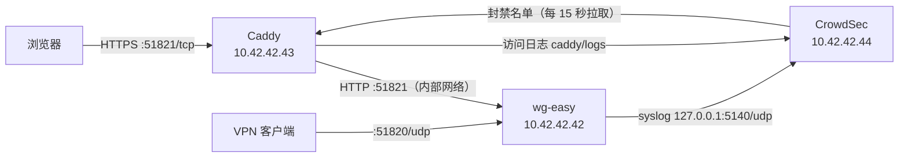

/// note | 适用范围

本文对应仓库根目录的 `docker-compose-dirty.yml`，以及 `caddy/`、`crowdsec/`、`scripts/caddy-image.sh`。如果只需要一个最简单的反向代理，看 [Caddy](./caddy.md) 即可。

///

这套部署在 wg-easy 前面加了一层 Caddy，并用 CrowdSec 自动封禁攻击者：

- Web UI 仍然使用 `51821/tcp`，但改为 HTTPS，证书自动申请和续期；在同一端口用 `http://` 访问会自动跳转到 `https://`
- 按 IP 限流登录、2FA、Basic 认证、一次性配置链接和普通 API
- CrowdSec 分析 Caddy 访问日志和 wg-easy 自己的安全日志，发现爆破后由 Caddy 直接拦截该 IP（默认 4 小时，2FA 爆破 24 小时，同一 IP 再犯时递增），可选推送到企业微信、钉钉或 Telegram

## 架构



Caddy 处理每个请求的顺序：

1. CrowdSec 封禁检查，已封禁的 IP 返回 403
2. 来源 IP 白名单（`WG_ALLOW_IPS`，`/cnf/*` 一次性链接除外）
3. `/metrics/*` 只允许内网 IP
4. 限流，超出返回 429
5. 压缩后转发给 wg-easy

### 端口

| 端口                 | 服务     | 说明                                               |
| -------------------- | -------- | -------------------------------------------------- |
| `51821/tcp`          | caddy    | Web UI（HTTPS），同端口的明文 HTTP 自动跳转        |
| `51820/udp`          | wg-easy  | WireGuard                                          |
| `80/tcp`             | caddy    | 只有 `http` 证书模式需要，其他模式可以删掉这一行   |
| `127.0.0.1:5140/udp` | crowdsec | 只在本机监听，接收 wg-easy 日志，外网访问不到      |

CrowdSec 的本地 API（8080）不对外发布，只有 Caddy 能通过内部网络访问。

## 前置条件

- Linux 服务器，Docker 20.10 或更高版本，Docker Compose v2
- 构建 Caddy 镜像时要能访问 Go 模块代理（默认 `goproxy.cn`）；也可以在别的机器上构建好推送到镜像仓库，服务器直接拉取
- 如果有用户通过 IPv6 访问 Web UI，Docker 必须开启 `ip6tables`，否则 Caddy 看到的来源 IP 全是 Docker 网关，限流和封禁都会失效。在 `/etc/docker/daemon.json` 中加入下面的配置后重启 Docker：

```json
{
    "ip6tables": true
}
```

## 第 1 步：准备 .env

```shell
cp .env.example .env
chmod 600 .env
# 生成 Caddy 与 CrowdSec 之间的通信密钥
sed -i "s/^CROWDSEC_BOUNCER_KEY=.*/CROWDSEC_BOUNCER_KEY=$(openssl rand -hex 32)/" .env
```

`.env` 里有云 API 密钥，不要提交到 git（`.gitignore` 已经忽略了它）。

### 选择证书模式

| `CADDY_TLS_MODE`   | 证书                       | 需要填写                                                    | 80 端口 |
| ------------------ | -------------------------- | ----------------------------------------------------------- | ------- |
| `internal`（默认） | Caddy 自签                 | 无，`WG_WEB_HOST` 可以是 IP                                 | 不需要  |
| `http`             | Let's Encrypt，HTTP 验证   | `ACME_EMAIL`；`WG_WEB_HOST` 是解析到本机的域名              | 需要    |
| `tencentcloud`     | Let's Encrypt，DNS 验证    | `ACME_EMAIL`、`TENCENTCLOUD_SECRET_ID`、`TENCENTCLOUD_SECRET_KEY` | 不需要  |
| `alidns`           | Let's Encrypt，DNS 验证    | `ACME_EMAIL`、`ALIYUN_ACCESS_KEY_ID`、`ALIYUN_ACCESS_KEY_SECRET`  | 不需要  |

- 只有 IP、没有域名时用 `internal`。浏览器会提示证书不受信任，导入根证书后提示消失（见下文“导入根证书”一节）。
- 国内服务器上未备案的域名可能被封 80 端口，HTTP 验证会失败，这时用 DNS 验证。
- DNS 验证的密钥请用子账号创建，只授予云解析的权限：腾讯云在 CAM 中授权“云解析 DNSPod”，阿里云在 RAM 中授权“云解析 DNS”。
- 不是 `http` 模式时，把 `docker-compose-dirty.yml` 里 caddy 的 `"80:80/tcp"` 删掉。

腾讯云 DNS 验证的 `.env` 示例：

```ini
WG_WEB_HOST=vpn.example.com
CADDY_TLS_MODE=tencentcloud
ACME_EMAIL=you@example.com
TENCENTCLOUD_SECRET_ID=AKIDxxxxxxxxxxxxxxxx
TENCENTCLOUD_SECRET_KEY=xxxxxxxxxxxxxxxx
```

### 其他配置项

| 变量                          | 默认值                                                  | 说明                                                                         |
| ----------------------------- | ------------------------------------------------------- | ---------------------------------------------------------------------------- |
| `WG_ALLOW_IPS`                | `0.0.0.0/0 ::/0`                                        | 允许访问 Web UI 的 IP/CIDR，空格分隔；不在名单内的连接直接断开               |
| `CADDY_HSTS`                  | `max-age=0`                                             | 换成正式证书并稳定运行后改为 `max-age=31536000`                              |
| `RL_LOGIN_PER_MIN`            | `5`                                                     | 每个 IP 每分钟允许的登录和 2FA 请求次数                                      |
| `RL_LOGIN_PER_HOUR`           | `30`                                                    | 每个 IP 每小时允许的登录和 2FA 请求次数                                      |
| `CADDY_DNS_RESOLVERS`         | `119.29.29.29 223.5.5.5`                                | DNS 验证时检查 TXT 记录用的 DNS 服务器                                       |
| `CROWDSEC_DISABLE_ONLINE_API` | `false`                                                 | `true` 表示只在本地运行，不连 CrowdSec 中央服务器，也收不到社区黑名单        |
| `CROWDSEC_ENROLL_KEY`         | 空                                                      | 可选，填入后实例会出现在 app.crowdsec.net 控制台                             |
| `CROWDSEC_IMAGE`              | `crowdsecurity/crowdsec:latest`                         | Docker Hub 拉不下来时换成自己的镜像仓库                                      |
| `CROWDSEC_NOTIFY`             | 空                                                      | 封禁通知渠道：`wecom`、`dingtalk`、`telegram`，留空不推送，见“封禁通知”一节  |
| `CADDY_IMAGE`                 | 空                                                      | 服务器直接拉取的 Caddy 镜像；留空则使用本地镜像或现场编译                    |
| `CADDY_IMAGE_REPO`            | `ccr.ccs.tencentyun.com/vpn-server/caddy-ratelimit-dns` | `scripts/caddy-image.sh` 的推送目标                                          |
| `CADDY_VERSION`               | `2`                                                     | 插件与最新 Caddy 不兼容导致编译失败时，固定到较早的小版本，如 `2.9`          |

## 第 2 步：准备 Caddy 镜像

官方 Caddy 镜像不包含限流、DNS 验证和 CrowdSec 插件，需要自己编译。

### 方式一：构建后推送到镜像仓库（推荐）

在构建机上运行：

```shell
docker login ccr.ccs.tencentyun.com
bash scripts/caddy-image.sh --no-push    # 先只构建和检查
bash scripts/caddy-image.sh              # 构建、检查并推送
```

脚本会检查镜像里的插件是否齐全，并在 4 种证书模式下分别运行 `caddy validate`，任何一项失败都不会推送。推送成功后会打印一个带日期和提交号的固定标签，填到服务器的 `.env`：

```ini
CADDY_IMAGE=ccr.ccs.tencentyun.com/vpn-server/caddy-ratelimit-dns:2.10.2-20261109-abc1234
```

其他参数：`--platform linux/amd64,linux/arm64` 构建多架构镜像，`--no-latest` 不更新 `latest` 标签，`-h` 查看帮助。

### 方式二：在服务器上直接编译

```shell
docker compose -f docker-compose-dirty.yml build caddy
docker compose -f docker-compose-dirty.yml run --rm --no-deps caddy \
    caddy validate --config /etc/caddy/Caddyfile
```

## 第 3 步：启动

```shell
# 使用方式一的镜像
docker compose -f docker-compose-dirty.yml pull caddy
docker compose -f docker-compose-dirty.yml up -d --no-build

# 使用方式二
docker compose -f docker-compose-dirty.yml up -d
```

CrowdSec 第一次启动时会从官方仓库下载 Caddy 解析器和通用 HTTP 攻击规则，需要等一会儿。Caddy 的证书申请过程在 `docker logs -f wg-easy-caddy` 中查看，出现 `certificate obtained successfully` 即表示证书已拿到。

/// warning | 已有部署升级时

wg-easy 改用了 syslog 日志驱动，容器会被重建，VPN 会断开几秒，建议在空闲时段执行。

///

## 第 4 步：验证

下面的 `<WG_WEB_HOST>` 换成 `.env` 中的值。`internal` 模式下 curl 需要加 `-k`。

### HTTPS 和自动跳转

```shell
curl -kI https://<WG_WEB_HOST>:51821    # 应返回 200
curl -I  http://<WG_WEB_HOST>:51821     # 应返回 308，Location 是 https://
```

如果用 `http://` 访问返回 400 `Client sent an HTTP request to an HTTPS server`，说明同端口跳转没有生效，见文末“排错”一节。

### 安全响应头

```shell
curl -skI https://<WG_WEB_HOST>:51821 | grep -iE 'strict-transport|x-frame|x-content-type|content-security|^server'
```

应该看到 HSTS、`X-Frame-Options`、`X-Content-Type-Options`、`Content-Security-Policy`，并且没有 `Server` 头。

### Caddy 拿到的是真实客户端 IP（最重要）

从外网访问几次 Web UI，然后：

```shell
tail -n 20 caddy/logs/access.log | grep -o '"client_ip":"[^"]*"' | sort | uniq -c
```

应该是访问者的公网 IP。如果全是 `10.42.42.1` 或 `fdcc:ad94:bacf:61a3::1`（Docker 网关），所有请求都会被当作内网放行，限流共用一个额度，CrowdSec 也永远不会封任何人。IPv6 访问出现这种情况时，检查“前置条件”中的 `ip6tables`。

### 限流

从公网 IP 连续提交 6 次错误密码，前 5 次返回 401，第 6 次返回 429：

```shell
for i in $(seq 6); do
    curl -sk -o /dev/null -w "%{http_code}\n" -X POST \
        -H 'Content-Type: application/json' \
        -d '{"username":"x","password":"x","remember":false}' \
        https://<WG_WEB_HOST>:51821/api/auth/password
done
```

### CrowdSec

```shell
# Caddy 已连上 CrowdSec：caddy 这一行的最后拉取时间在不断更新
docker exec wg-easy-crowdsec cscli bouncers list

# 两条日志都在读：caddy/logs/access.log 和 syslog 的行数都在增长
docker exec wg-easy-crowdsec cscli metrics

# 本项目的 5 条规则和 1 个解析器都已加载
docker exec wg-easy-crowdsec cscli scenarios list | grep wg-easy
docker exec wg-easy-crowdsec cscli parsers list | grep wg-easy
```

确认 wg-easy 的 2FA 失败日志能被识别（结果中 `wg-easy/security-logs` 应显示成功，`wg-easy/2fa-bf` 应收到这条事件）：

```shell
docker exec wg-easy-crowdsec cscli explain --type syslog \
    --log 'Nov  9 17:00:00 host wg-easy[1]: Security failure: type=2fa ip=203.0.113.9'
```

最后手动封一个测试 IP，等 15 秒后从该 IP 访问应返回 403。测完用 `alerts delete` 清掉，它会连同封禁记录一起删除，不会让这个 IP 以后的封禁时长递增：

```shell
docker exec wg-easy-crowdsec cscli decisions add --ip <测试IP> --duration 5m
docker exec wg-easy-crowdsec cscli alerts delete --ip <测试IP>
```

测试递增：先给测试 IP 加两次 1 分钟的手动封禁，等它们过期（约 1 分 15 秒），再从该 IP 访问 6 次不存在的一次性链接，触发 `wg-easy/cnf-enum`。这次封禁应为 12 小时（按第 3 次算），测完同样用 `alerts delete` 清掉：

```shell
docker exec wg-easy-crowdsec cscli decisions add --ip <测试IP> --duration 1m
docker exec wg-easy-crowdsec cscli decisions add --ip <测试IP> --duration 1m
# 约 1 分 15 秒后，在测试 IP 上执行
for i in $(seq 6); do curl -sk -o /dev/null -w "%{http_code}\n" https://<WG_WEB_HOST>:51821/cnf/test$i; done
# 回到服务器，Duration 一列应接近 12h
docker exec wg-easy-crowdsec cscli decisions list --ip <测试IP>
docker exec wg-easy-crowdsec cscli alerts delete --ip <测试IP>
```

/// note | 测试要用公网 IP

内网地址（`10.0.0.0/8`、`172.16.0.0/12`、`192.168.0.0/16` 等）默认在 CrowdSec 白名单里，从局域网怎么测都不会被封。

///

## 检测规则

规则定义在 `crowdsec/scenarios/wg-easy.yaml`。封禁时长在 `crowdsec/profiles.yaml` 中设置：`wg-easy/2fa-bf` 首次封 24 小时，其余规则首次封 4 小时，同一 IP 再犯时递增（见下文“重复违规递增封禁”）。

| 规则                       | 判断依据                                                    | 触发条件                                 |
| -------------------------- | ----------------------------------------------------------- | ---------------------------------------- |
| `wg-easy/password-bf`      | `POST /api/auth/password` 返回 401                          | 同一 IP 超过 10 次（每分钟抵消 1 次）    |
| `wg-easy/credential-bf`    | 带 `Authorization` 头访问 `/api/*` 仍返回 401               | 同一 IP 超过 10 次（每分钟抵消 1 次）    |
| `wg-easy/cnf-enum`         | `/cnf/*` 返回 404（链接无效或已被使用）                     | 同一 IP 超过 5 次（每分钟抵消 1 次）     |
| `wg-easy/rate-limit-abuse` | 收到 Caddy 返回的 429                                       | 同一 IP 超过 20 次（每 30 秒抵消 1 次）  |
| `wg-easy/2fa-bf`           | wg-easy 日志 `Security failure: type=2fa`（验证码错误）     | 同一 IP 超过 5 次（每 2 分钟抵消 1 次）  |

另外还会启用 CrowdSec 官方的 `crowdsecurity/caddy` 规则集（目录扫描、已知漏洞探测等）。

wg-easy 在 2FA 验证码错误时返回 HTTP 200，访问日志看不出来，所以 `2fa-bf` 改为读取 wg-easy 自己的日志。日志通过 Docker 的 syslog 日志驱动发给 CrowdSec，不需要挂载 `docker.sock`。解析器只取每行最后一个 `ip=`，用户名里写入的 `ip=...` 不会被当作来源 IP，攻击者无法借此让别人被封。

/// danger | 2FA 规则被触发

能走到 2FA 这一步，说明攻击者已经输对了密码。看到 `wg-easy/2fa-bf` 告警时，请立即修改该账号的密码。

///

### 重复违规递增封禁

同一个 IP 再次被封时，封禁时长按它过去 7 天内已有的封禁次数递增：

| 规则                                  | 第 1 次 | 第 2 次 | 第 3 次 | 之后          | 上限          |
| ------------------------------------- | ------- | ------- | ------- | ------------- | ------------- |
| `wg-easy/2fa-bf`                      | 24h     | 48h     | 72h     | 每次加 24h    | 168h（7 天）  |
| 其他 wg-easy 规则、CrowdSec 官方规则  | 4h      | 8h      | 12h     | 每次加 4h     | 72h           |
| 网段封禁                              | 4h      | 4h      | 4h      | 不递增        | -             |

- 次数不分规则：一个 IP 先因扫描被封过 2 次，再爆破 2FA，按第 3 次算，封 72 小时
- 7 天与 CrowdSec 默认的告警保留时长一致，更早的记录会被清理，计数自然归零
- 计算公式写在两份 profiles 文件的 `duration_expr` 中，`decisions` 下的 `duration` 是公式出错时的兜底值

## 封禁通知

可选。CrowdSec 封禁 IP 时推送一条消息到企业微信、钉钉或 Telegram 群。

- 只推送 wg-easy 专用规则（上表 5 条）的封禁；官方规则（扫描、漏洞探测）照常封禁但不推送，避免刷屏
- 30 秒内的多次封禁合并成一条消息，一条最多列 8 个 IP
- `wg-easy/2fa-bf` 标为高危，消息里提示修改密码，并 @所有人（Telegram 不支持 @所有人）
- 社区黑名单下发的封禁不经过本地规则，不会推送

### 配置

在 `.env` 中选择渠道并填写对应的密钥，其余渠道的密钥留空：

| `CROWDSEC_NOTIFY` | 需要填写                                              | 获取方式                                                                                     |
| ----------------- | ----------------------------------------------------- | -------------------------------------------------------------------------------------------- |
| 留空（默认）      | 无                                                    | 不推送                                                                                       |
| `wecom`           | `NOTIFY_WECOM_KEY`                                    | 企业微信群 → 添加群机器人，webhook 地址中 `key=` 后面的部分                                  |
| `dingtalk`        | `NOTIFY_DINGTALK_TOKEN`                               | 钉钉群设置 → 机器人 → 自定义机器人，webhook 地址中 `access_token=` 后面的部分                |
| `telegram`        | `NOTIFY_TELEGRAM_TOKEN`、`NOTIFY_TELEGRAM_CHAT_ID`    | @BotFather 创建机器人得到 token；给机器人发一条消息后，访问 `getUpdates` 接口查看 `chat.id`  |

/// warning | 钉钉安全设置

钉钉机器人的安全设置必须选“自定义关键词”，关键词填 `wg-easy`。不支持“加签”：签名要按发送时间实时计算，而 CrowdSec 的推送地址是固定的。

///

修改后重建 CrowdSec 容器：

```shell
docker compose -f docker-compose-dirty.yml up -d crowdsec
```

`CROWDSEC_NOTIFY` 决定挂载哪两个文件：留空时挂载 `crowdsec/profiles.yaml` 和占位文件 `crowdsec/notifications/off.yaml`，有值时挂载 `crowdsec/profiles-notify.yaml` 和 `crowdsec/notifications/<渠道>.yaml`。只能填上表中的值，填错时 Docker 会把不存在的路径当作目录创建，通知不会生效。

### 验证

```shell
# wg_easy_notify 一行应显示已启用，并关联 wg_easy_2fa_bf、wg_easy_ip_remediation 两个规则
docker exec wg-easy-crowdsec cscli notifications list

# 发一条测试消息（直接发给通知插件，不经过处置规则）
docker exec wg-easy-crowdsec cscli notifications test wg_easy_notify
```

部分 CrowdSec 版本的 `cscli notifications test` 不会展开推送地址里的环境变量，测试消息收不到但实际封禁能正常推送。可以用真实告警重新走一遍处置流程来验证：

```shell
docker exec wg-easy-crowdsec cscli alerts list                     # 找一条 wg-easy/ 开头的告警 ID
docker exec wg-easy-crowdsec cscli notifications reinject <告警ID>
```

还没有 wg-easy 告警时，按“第 4 步：验证”从公网 IP 连续输错 6 次 2FA 验证码，就会产生一条高危告警和推送，测完记得解封。

### 推送官方规则的封禁

编辑 `crowdsec/profiles-notify.yaml`，取消 `default_ip_remediation` 下 `notifications` 两行的注释，然后执行 `docker restart wg-easy-crowdsec`。

## 日常运维

### 查看日志和封禁

```shell
tail -f caddy/logs/access.log                       # Caddy 访问日志（JSON）
docker logs -f wg-easy                              # wg-easy 日志
docker logs -f wg-easy-caddy                        # Caddy 运行日志（证书申请等）
docker exec wg-easy-crowdsec cscli alerts list      # 告警记录
docker exec wg-easy-crowdsec cscli decisions list   # 当前封禁
docker exec wg-easy-crowdsec cscli decisions delete --ip <IP>   # 解封
docker exec wg-easy-crowdsec cscli alerts delete --ip <IP>      # 解封并清零递增计数
```

### 管理员 IP 白名单

两处白名单作用不同，可以同时使用：

- **永不被封**：编辑 `crowdsec/parsers/s02-enrich/wg-easy-whitelist.yaml`，然后 `docker restart wg-easy-crowdsec`
- **只允许这些 IP 访问 Web UI**：修改 `.env` 中的 `WG_ALLOW_IPS`，然后 `docker compose -f docker-compose-dirty.yml up -d caddy`

### 调整封禁时长

封禁时长在 `crowdsec/profiles.yaml` 和 `crowdsec/profiles-notify.yaml` 中，两份文件要保持一致。修改递增步长或上限时，改 `duration_expr` 里的数字（如 `* 4` 和 `72`），同一行出现两次的数字要一起改；`duration_expr` 必须和 `decisions` 平级，写进 `decisions` 下面不会生效。改完先检查配置，再重启：

```shell
docker exec wg-easy-crowdsec crowdsec -t
```


```shell
docker restart wg-easy-crowdsec
```

### 更新和回滚 Caddy 镜像

在构建机上重新运行 `bash scripts/caddy-image.sh`，把新的固定标签填到服务器 `.env` 的 `CADDY_IMAGE`，然后：

```shell
docker compose -f docker-compose-dirty.yml pull caddy
docker compose -f docker-compose-dirty.yml up -d --no-build caddy
```

回滚时把 `CADDY_IMAGE` 改回旧标签，再执行一次上面两条命令。

### 更新 CrowdSec 规则

```shell
docker exec wg-easy-crowdsec cscli hub update
docker exec wg-easy-crowdsec cscli hub upgrade
docker restart wg-easy-crowdsec
```

### 更换 CrowdSec 通信密钥

CrowdSec 只在第一次注册时读取 `CROWDSEC_BOUNCER_KEY`，之后修改需要先删除旧的注册：

```shell
docker exec wg-easy-crowdsec cscli bouncers delete caddy
# 修改 .env 中的 CROWDSEC_BOUNCER_KEY 后
docker compose -f docker-compose-dirty.yml up -d --force-recreate crowdsec caddy
```

### 导入根证书（internal 模式）

`internal` 模式的根证书在 `caddy/data/caddy/pki/authorities/local/root.crt`。复制到客户端后：

- Windows：双击证书，选择“安装证书”，存储位置选“受信任的根证书颁发机构”
- macOS：用“钥匙串访问”导入，并设为“始终信任”
- 手机：在系统设置中安装证书并手动启用信任

不要删除 `caddy/data`，否则会重新生成根证书，客户端需要重新导入。

### 备份

| 路径                  | 内容                                     |
| --------------------- | ---------------------------------------- |
| `data/`               | WireGuard 私钥和 wg-easy 数据库，最重要  |
| `caddy/data/`         | 证书、私钥、ACME 账号、自签根证书        |
| `.env`                | 所有配置和密钥                           |
| `crowdsec_config` 卷  | CrowdSec 配置（可选，丢失后会自动重建）  |

## 排错

| 现象                                                         | 原因和处理                                                                                                                                 |
| ------------------------------------------------------------ | ------------------------------------------------------------------------------------------------------------------------------------------ |
| compose 报 `请在 .env 中设置 ...`                            | `WG_WEB_HOST` 或 `CROWDSEC_BOUNCER_KEY` 没有填写                                                                                           |
| `http://` 访问返回 400 `Client sent an HTTP request to an HTTPS server` | Caddyfile 中站点地址被加了 `bind`，导致 `servers :51821` 匹配不上，跳转失效。去掉 `bind` 即可                              |
| `http` 模式证书申请失败                                      | 确认域名解析到本机、80 端口公网可达；国内未备案域名可能被封 80 端口，改用 DNS 验证                                                         |
| DNS 模式证书申请失败                                         | 确认域名托管在所选的云厂商、密钥有云解析权限；在 `docker logs wg-easy-caddy` 中查看具体错误                                                |
| 编译 Caddy 镜像失败，错误与 `libdns` 有关                    | 插件与最新 Caddy 不兼容，在 `.env` 中设置 `CADDY_VERSION=2.9` 后重新编译                                                                   |
| Caddy 启动报 `permission denied`                             | 容器去掉了越权写文件的权限，执行 `sudo chown -R root:root caddy/data caddy/config caddy/logs`                                              |
| 登录不了或频繁返回 429                                       | 多个用户共用一个出口 IP（如公司网络），适当调大 `RL_LOGIN_PER_MIN`，或把该 IP 加入 CrowdSec 白名单                                         |
| 访问日志里 `client_ip` 全是 Docker 网关地址                  | 见“第 4 步：验证”中的真实 IP 检查，IPv6 需要开启 `ip6tables`                                                                                          |
| `cscli bouncers list` 中 caddy 没有拉取记录                  | 两边密钥不一致，按“更换 CrowdSec 通信密钥”一节重新注册                                                                            |
| `cscli metrics` 中 syslog 行数为 0                           | 检查 Docker 版本（需 20.10+），以及 `docker inspect wg-easy --format '{{.HostConfig.LogConfig}}'` 是否为 syslog 驱动                       |
| 自己被封了                                                   | 在服务器上执行 `cscli alerts delete --ip <IP>`（解封并清零递增计数），并把自己的 IP 加入 CrowdSec 白名单                                                      |
| 收不到封禁通知                                               | 先看“封禁通知 → 验证”；再看 `docker logs wg-easy-crowdsec` 中 `http-plugin` 的报错。国内服务器通常连不上 Telegram                          |

## 已知限制

- 云 API 密钥、CrowdSec 通信密钥和通知机器人密钥通过环境变量传入容器，有 Docker 权限的人用 `docker inspect` 能看到
- 限流计数只保存在内存中，重启 Caddy 会清零；长期封禁依靠 CrowdSec
- 递增计数只看过去 7 天；长期反复出现的攻击者，封禁时长最多到上限（2FA 爆破 7 天，其余 72 小时）
- 递增计数按 IP 统计所有封禁记录，可能包括社区黑名单下发的封禁，所以上过黑名单的 IP 首次在本机触发规则时可能直接按较长时长封禁
- CrowdSec 重启期间，wg-easy 发来的日志会丢失（UDP 非阻塞发送）；Caddy 访问日志是读文件，不受影响
- 为了不影响前端，CSP 只包含 `frame-ancestors`、`object-src`、`base-uri` 三项
- 只防护 Web UI（`51821/tcp`）；WireGuard（`51820/udp`）本身不会回应没有正确密钥的数据包

更多关于 `TRUSTED_PROXIES` 的说明见 [可选配置](../../advanced/config/optional-config.md#trusted-proxies)。
